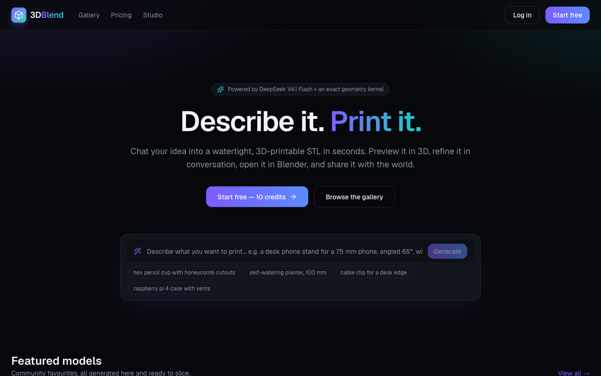

# 3DBlend — AI‑generated, 3D‑printable models from a chat

     -19d3c5) 

Describe an object in the chat, get back a **watertight, printable STL** plus a **Blender Python script** that rebuilds it with native primitives and booleans. Preview it in 3D, refine it in conversation, publish it to a gallery with likes and social sharing, and download it. Credit‑based plans: Free (10 credits), Starter (100/month), Pro (1000/month).

Inspired by Meshy AI and Tripo AI, built for Blender users and FDM printers.

## Live Demo

**https://3dblend.tertiaryinfotech.com** — hosted on Hostinger via Coolify. Every push to `main` is deployed automatically through a GitHub webhook.



## Features

- **Chat‑to‑STL studio** — streaming status while the agent designs, builds, checks and repairs the model; every version is kept and switchable.
- **Native agent harness** (`src/agent/`) — DeepSeek V4.1 Flash emits a tiny JSON CSG language; a deterministic kernel builds it; printability checks feed errors back for automatic repair. Runs from the CLI too.
- **Exact geometry** — [Manifold](https://github.com/elalish/manifold) (WASM) booleans always produce watertight 2‑manifolds. Models are auto‑seated on the bed (min Z = 0, centred).
- **Printability report** — build‑volume fit, bed contact %, overhang %, wall‑thickness heuristic, shell count, filament grams and print‑time estimates.
- **3MF export** — on‑demand `.3mf` (units, indexed mesh, metadata) for Bambu Studio, PrusaSlicer and Cura, derived from the stored STL and cached.
- **Blender‑friendly export** — a `.blender.py` per model that recreates the design with `bmesh` primitives, EXACT booleans, arrays and mirrors, in millimetres, sitting on the build plate.
- **3D viewer** — React Three Fiber, orbit/zoom, auto‑rotate, grid and contact shadows.
- **Gallery & social** — auto‑rotating 3D cards, publish/unpublish, thumbs‑up, view & download counters, share to X / Facebook / LinkedIn / WhatsApp / Reddit, copy link, Web Share API, *Remix in studio*.
- **Accounts & credits** — email/password auth (Auth.js), atomic credit deduction, refunds on failure, Stripe subscription checkout + webhook (optional), monthly top‑up cron endpoint.
- **Sample content** — six featured models (phone stand, honeycomb pencil cup, planter, headphone hook, spur gear, twisted vase) are built by the real kernel on first run.

## Architecture

```
┌────────────┐   SSE    ┌──────────────────────┐    OpenAI-compatible    ┌───────────────────┐
│  Next.js   │ ◄──────► │  /api/chat (harness) │ ──────────────────────► │ DeepSeek V4.1     │
│  App Router│          │  validate → build →   │ ◄────── JSON spec ───── │ Flash             │
│  R3F viewer│          │  check → repair loop  │                         └───────────────────┘
└─────┬──────┘          └──────────┬───────────┘
      │ Prisma                     │ Manifold (WASM)  →  binary STL + Blender .py
      ▼                            ▼
┌────────────┐          ┌──────────────────────┐
│ PostgreSQL │          │  STORAGE_DIR volume   │
└────────────┘          └──────────────────────┘
```

### The agent harness

```
user idea ─► LLM ─► { message, spec } ─► zod validation ─► Manifold build ─► printability checks ─► STL + .py
                ▲                                 │                 │                   │
                └──────── repair prompt with the exact errors ◄─────┴───────────────────┘   (max 4 attempts)
```

The model never touches geometry directly. It writes a declarative **spec** in a ~20‑op CSG DSL (`cube`, `cylinder`, `sphere`, `cone`, `torus`, `roundedBox`, `extrude`, `revolve`, `union`, `difference`, `intersection`, `hull`, `translate`, `rotate`, `scale`, `mirror`, `repeat`, `radial`, `ref`/`parts`). The harness owns every side effect, which keeps generation deterministic, cheap (one LLM call per attempt, ~3 s), replayable, and safe to expose publicly.

Key files:

| File | Purpose |
| --- | --- |
| `src/agent/spec.ts` | DSL schema (zod) and semantic validation (refs, cycles, size limits) |
| `src/agent/kernel.ts` | Manifold builder → positions/indices, volume, bbox, genus, shells |
| `src/agent/checks.ts` | Printability analysis (errors block, warnings inform) |
| `src/agent/stl.ts` | Binary STL writer + parser |
| `src/agent/threemf.ts` | 3MF (zip + XML) writer |
| `src/agent/blender.ts` | Spec → self‑contained `bpy` script |
| `src/agent/llm.ts` | DeepSeek client (OpenAI SDK, non‑thinking mode, JSON output) |
| `src/agent/harness.ts` | The generate → validate → build → check → repair loop |
| `src/agent/prompts.ts` | System prompt with the DSL reference and FDM design rules |
| `scripts/agent-cli.ts` | `npm run agent -- "a hex pencil cup"` → `out/*.stl`, `*.blender.py`, `*.spec.json` |

> **Why non‑thinking mode?** DeepSeek V4.x in thinking mode spends its entire token budget reasoning about geometry and returns empty content for anything non‑trivial. The harness supplies the verification loop instead, and direct mode answers in ~3 s. Set `DEEPSEEK_THINKING=1` to opt back in.

## Quick start (local)

```bash
git clone https://github.com/alfredang/3dblend.git && cd 3dblend
npm install
cp .env.example .env            # fill DEEPSEEK_API_KEY, DATABASE_URL, AUTH_SECRET
docker run -d --name 3dblend-pg -e POSTGRES_USER=blend -e POSTGRES_PASSWORD=blend -e POSTGRES_DB=blend -p 5544:5432 postgres:16-alpine
npm run db:push                 # create tables
npm run db:seed                 # demo users + 6 featured models (optional; also happens on first page view)
npm run dev                     # http://localhost:3000
```

Demo login: `demo@3dblend.app` / `demo1234` (Pro plan, 1000 credits).

Try the harness without the web app:

```bash
npm run agent -- "a desk phone stand for a 75mm wide phone, angled 65 degrees, with a cable slot"
# → out/phone-stand.stl, out/phone-stand.blender.py, out/phone-stand.spec.json
```

## Environment variables

| Variable | Required | Notes |
| --- | --- | --- |
| `DEEPSEEK_API_KEY` | ✅ | DeepSeek API key |
| `DEEPSEEK_BASE_URL` | | default `https://api.deepseek.com` |
| `DEEPSEEK_MODEL` | | default `deepseek-flash` (= DeepSeek‑V4.1‑Flash) |
| `DATABASE_URL` | ✅ | PostgreSQL connection string |
| `AUTH_SECRET` | ✅ | `openssl rand -base64 32` |
| `NEXT_PUBLIC_APP_URL` / `NEXTAUTH_URL` | ✅ | public URL (share links, Stripe redirects) |
| `STORAGE_DIR` | | where STL / .py files live (`/data/storage` in Docker, mount a volume) |
| `STRIPE_SECRET_KEY`, `STRIPE_WEBHOOK_SECRET`, `STRIPE_PRICE_STARTER`, `STRIPE_PRICE_PRO` | | enable paid upgrades; without them the UI shows “Coming soon” |
| `CRON_SECRET` | | protects `GET /api/cron/reset-credits` (monthly top‑ups) |
| `SEED_ON_BOOT` | | `0` disables auto‑seeding of sample models |

## Deploy on Hostinger with Coolify (CI/CD)

The production instance was created through the Coolify API; the same steps work from the UI:

1. **New Resource → Public Repository**, URL `https://github.com/alfredang/3dblend`, branch `main`, build pack **Docker Compose**, compose file `/docker-compose.yml`. Coolify builds the multi‑stage `Dockerfile` (Next.js standalone output) and brings up the bundled PostgreSQL 16 service with persistent `pgdata` and `storage` volumes.
2. Set the environment variables above in the resource's *Environment* tab (`POSTGRES_PASSWORD`, `DEEPSEEK_API_KEY`, `AUTH_SECRET`, `NEXT_PUBLIC_APP_URL`, `CRON_SECRET`). Coolify pre‑creates the keys from the compose file.
3. Domain for the `web` service: `https://3dblend.tertiaryinfotech.com:3000` (the `:3000` tells the Traefik proxy which container port to route to; the service is not published on the host). Coolify provisions TLS.
4. **CI/CD webhook**: in the GitHub repo, *Settings → Webhooks → Add*, payload URL `https://<coolify-host>/webhooks/source/github/events/manual`, content type `application/json`, secret = the application's *Manual webhook secret* (Coolify → app → Webhooks), event *push*. With *Auto Deploy* enabled, every push to `main` redeploys. Manual trigger: `POST /api/v1/deploy?uuid=<app-uuid>` with a Coolify API token.
5. On every boot the entrypoint runs `prisma db push` so the schema is always in sync; sample models are seeded on the first page view.
6. Optional: a Coolify *Scheduled Task* that runs daily:
   `curl -fsS -H "x-cron-secret: $CRON_SECRET" https://3dblend.tertiaryinfotech.com/api/cron/reset-credits`
7. Optional: point a Stripe webhook at `https://3dblend.tertiaryinfotech.com/api/billing/webhook` for `checkout.session.completed`, `invoice.paid`, `customer.subscription.deleted`.

Local run of the same stack: `docker compose -f docker-compose.yml -f docker-compose.local.yml up --build` (the override publishes port 3000).

Health check: `GET /api/health`.

## API overview

| Route | Method | Description |
| --- | --- | --- |
| `/api/register` | POST | create account (10 free credits) |
| `/api/auth/*` | | Auth.js credentials provider |
| `/api/projects` | GET / POST | list / create chat projects |
| `/api/chat` | POST (SSE) | run the agent for a project; events `status`, `message`, `model`, `credits`, `error` |
| `/api/models/:id/stl` | GET | binary STL (`?download=1` counts a download) |
| `/api/models/:id/3mf` | GET | 3MF package (`?download=1` counts a download) |
| `/api/models/:id/blender` | GET | Blender Python script |
| `/api/models/:id/like` | POST | toggle thumbs‑up |
| `/api/models/:id/publish` | POST | toggle gallery visibility, edit title/description |
| `/api/models/:id/remix` | POST | copy a public model into a new project of yours |
| `/api/billing/checkout` | POST | Stripe Checkout session for `STARTER` / `PRO` |
| `/api/billing/webhook` | POST | Stripe events → plan + credits |
| `/api/cron/reset-credits` | GET | monthly credit top‑up (secret header) |
| `/api/health` | GET | DB connectivity |

## Data model

`User` (plan, credits, Stripe ids) → `Project` → `Message` (role, content, optional `modelId`) and `Model` (spec JSON, stats JSON, `stlPath`, `blenderPath`, `isPublic`, `featured`, counters) with `Like` (user × model) and `CreditTransaction` (audit log).

## Tech stack

Next.js 16 (App Router, standalone output) · React 19 · TypeScript · Tailwind CSS 4 · Prisma 6 + PostgreSQL 16 · Auth.js v5 · OpenAI SDK → DeepSeek · manifold‑3d (WASM) · three.js / @react‑three/fiber / drei · Stripe · Docker / Coolify.

## Acknowledgements

- [Manifold](https://github.com/elalish/manifold) — the exact mesh boolean kernel that makes watertight output possible.
- [Blender](https://www.blender.org/) — the `.blender.py` exporter targets Blender 3.6+.
- [Meshy AI](https://www.meshy.ai/) and [Tripo AI](https://www.tripo3d.ai/) — product inspiration for the studio / gallery experience.
- [DeepSeek](https://www.deepseek.com/) — V4.1 Flash powers the design agent.

## License

MIT © Alfred Ang. Gallery models are shared by their authors under CC BY 4.0 unless stated otherwise.
